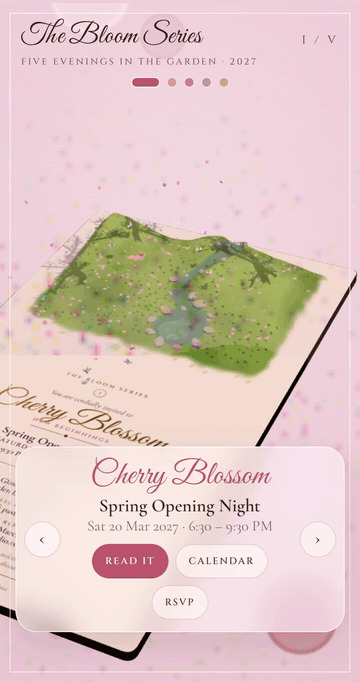
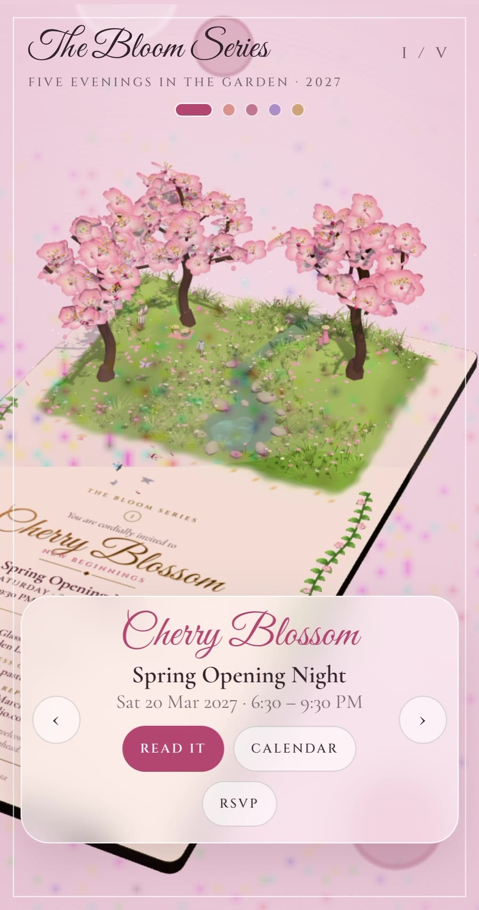
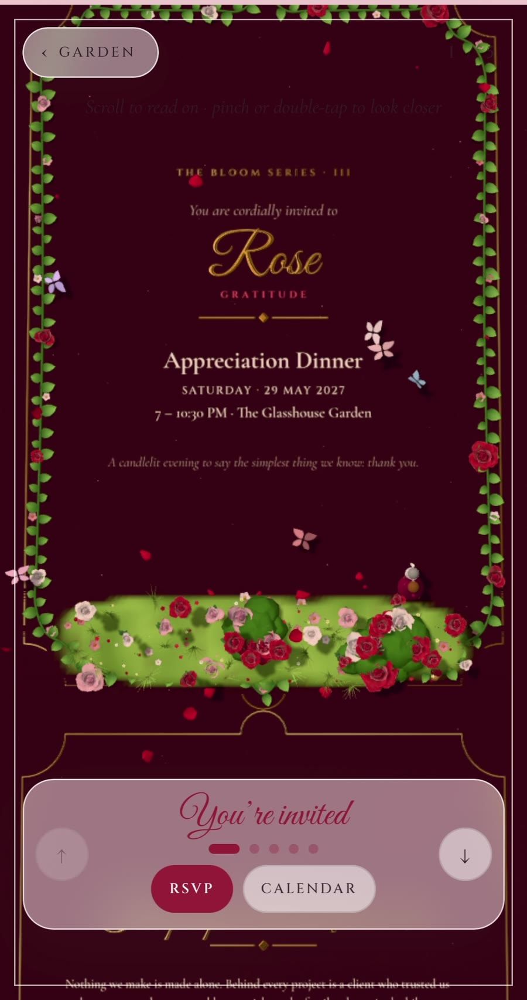
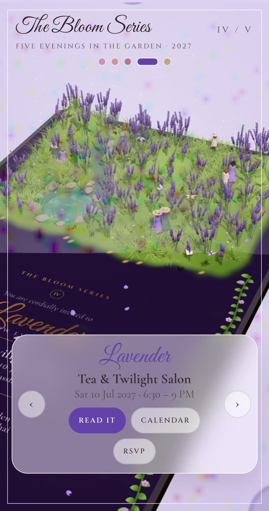
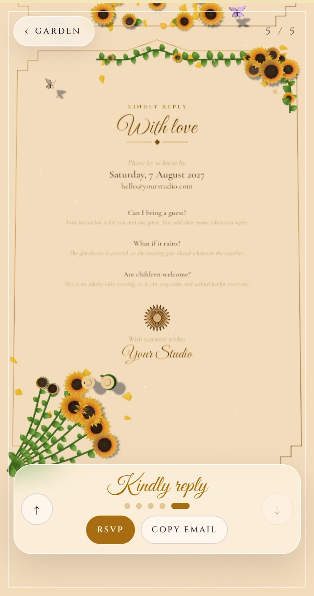

# The Bloom Series: 3D Garden Invitations

**[▶ Live demo](https://kheleey.github.io/bloom-invitations/)** · Free to use under the [MIT License](LICENSE)

<p align="center"></p>

### 🎬 Video tour

<a href="https://kheleey.github.io/bloom-invitations/tour.mp4"></a>

**[▶ Watch the full video tour](https://kheleey.github.io/bloom-invitations/tour.mp4)**

### Screenshots

<table><tr><td align="center"><br><sub>Cherry Blossom garden</sub></td><td align="center"><br><sub>Rose: the invitation page</sub></td><td align="center"><br><sub>Lavender garden</sub></td><td align="center"><br><sub>Sunflower: the reply page</sub></td></tr></table>

Five event invitations, one per flower: Cherry Blossom, Tulip, Rose, Lavender and Sunflower. Each one is a living 3D card with its own garden growing on it. The garden has wind, butterflies and tiny guests strolling, chatting and picnicking.

Open a card and it unfolds into five pages you scroll through:

1. The invitation
2. The story behind the event
3. The programme
4. Practical details
5. The RSVP

Every invitation has its own frame shape and its own flower arrangements. You can pinch or double-tap to zoom in, add the event to Google Calendar, get directions, and send an RSVP.

## Gifts, cheers and wishes

Tap the gift button above the invitation to send a little something:

- **Gifts:** a gift box, a bouquet of the invitation's own flower, balloons, a heart or a cake, thrown in 3D. They land in the garden or on the page with a sparkle. Balloons float away.
- **Cheers:** quick words like "Congratulations!" that float up the screen.
- **Wishes:** a guestbook where guests leave a message.

With Supabase connected (below), **every guest sees them**. Gifts land live on everyone's screen, gifts left earlier are already in the garden, in the same spot for everyone, and wishes form one shared guestbook. Each guest can switch other guests' gifts and wishes off with **Show guests' gifts & wishes** in the gift tray, and the choice is remembered on their device.

Without Supabase, everything still works but stays on each guest's own device.

### Connect Supabase (free, about 10 minutes)

1. Create a free account at [supabase.com](https://supabase.com) and click **New project**. Any name works, and pick the region closest to your guests.
2. Open **SQL Editor → New query**, paste everything from [`supabase-setup.sql`](supabase-setup.sql), and click **Run**.
3. Go to **Project Settings → API**. Copy the **Project URL** and the **anon public** key (newer projects call it the **publishable** key). Never copy the `service_role` or **secret** key.
4. In `index.html`, find `social:` near the top and paste them in:
   ```js
   social: { supabaseUrl: 'https://xxxx.supabase.co', supabaseKey: 'your-anon-key', showOthers: true },
   ```
   These two values are meant to be public. The setup script only lets guests add gifts, cheers and wishes. Nobody can edit or delete them except you.
5. Commit and push. Done.

**Removing something rude:** in Supabase, open **Table Editor → bloom_events**, select the row and delete it.

**Staying awake:** free Supabase projects pause after a week without visitors. The included GitHub Action, [`.github/workflows/keep-supabase-awake.yml`](.github/workflows/keep-supabase-awake.yml), visits the database every three days so that never happens. It reads the settings from `index.html`, so there's nothing to configure. GitHub pauses scheduled actions in repositories with no commits for 60 days. It emails you first, and one click on **Enable workflow** in the Actions tab turns it back on.

## Make it yours

Everything you'll want to change is in the `window.BLOOM` block near the top of `index.html`:
- the series name, host, venue, address and RSVP email
- for each invitation: the title, date, times, dress code, welcome message, story, programme, notes and FAQ

## Built with

A single HTML file of plain JavaScript and [Three.js](https://threejs.org), which loads from a CDN, so it needs an internet connection. Fonts are from Google Fonts. The flowers are generated in code, with no 3D models.

## Use it for your own

1. Click **Fork** at the top of this page, or **Code → Download ZIP**.
2. Open `index.html` in any text editor and change the content block near the top.
3. Publish it with GitHub Pages (below), or open `index.html` in a browser.

Free to use, change and share, including commercially. Please keep the `LICENSE` file.

## Publish it as a website (GitHub Pages)

1. Upload this folder's files to a new **public** GitHub repository.
2. Go to **Settings → Pages**, choose **Deploy from a branch**, pick `main` and `/ (root)`, then click **Save**.
3. After a minute or two it's live at `https://<your-username>.github.io/<repo-name>/`.

You can also just open `index.html` in a browser.

## License

MIT. See [LICENSE](LICENSE).
